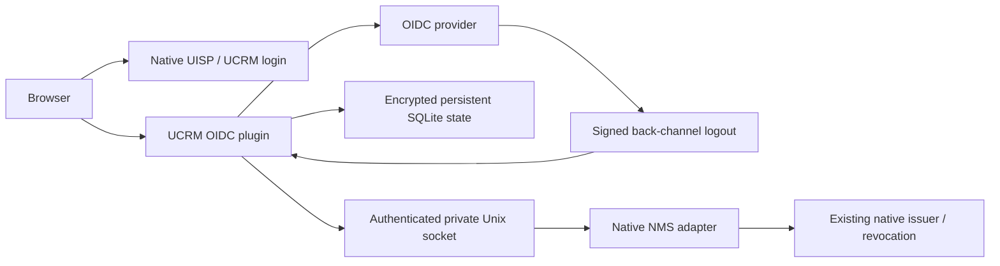

# Architecture

The PHP plugin is an OpenID Connect relying party. It verifies provider identity
and asks a private Node adapter to use the existing native NMS session issuer.
Both NMS and CRM consume that native session through their normal paths. The
adapter does not replace the native session validator or authorization model.

The adapter runs at the version-checked native API startup seam. Current UISP
uses the primary API process with its normal workers; the latest supported
profile separates API and device WebSocket roles. Only API receives the adapter.
No general command executor, Docker socket or public issuance endpoint is added.
The [wire contract](../adapter/CONTRACT.md) defines request authentication,
nonce/epoch checks and native receipt handling.

After provider validation, OIDC issues a native session directly, including for
accounts with native TOTP enabled. The provider owns authentication and MFA on
this path; configure the required assurance there. The adapter never disables or
edits native TOTP settings. The unchanged native password routes continue to
require native MFA. Existing account eligibility and permission checks apply to
both kinds of OIDC account, and no browser parameter can select a bypass.

The SQLite database and installation key live outside the removable plugin
directory. State includes encrypted credentials, one-use browser transactions,
stable bindings, audit, native cleanup receipts and logout event/fence tables.
Schema 2 preserves legacy records for receipt-scoped cleanup and refuses old
schema-1 readers. Migration never guesses a provider client ID or session ID.

Back-channel logout matches the configured issuer/client and verified subject
or provider session. A repeated event retains its first target set and cutoff;
it cannot become a fresh revocation sweep. Admission fences and transaction
coordination cover callbacks racing with native issuance. Uncertain outcomes
remain pending for bounded native maintenance rather than retrying issuance.

Established sessions have native lifetime and permissions. There is no refresh
lease, periodic provider-session polling, user provisioning, profile sync or
external permission mapping. Native customer login/impersonation remains native;
the plugin does not add Client Zone OIDC.
